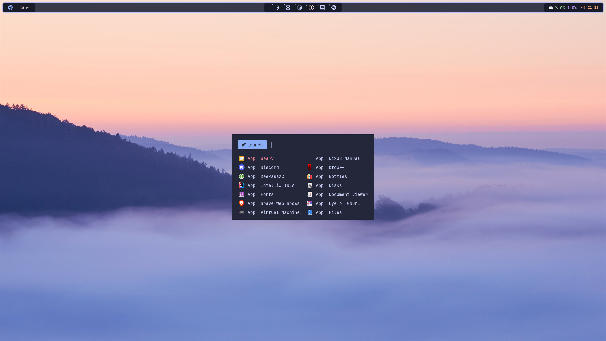
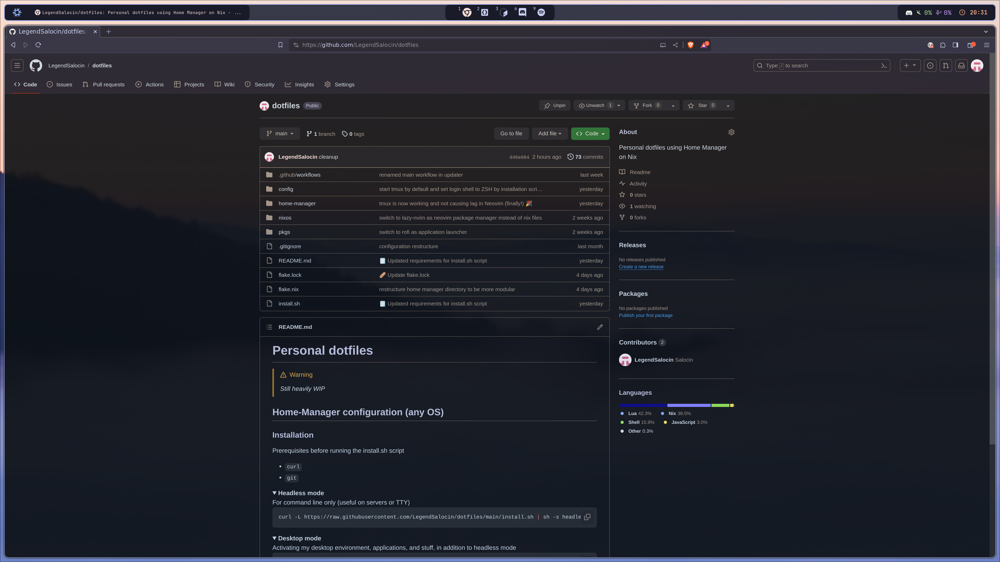
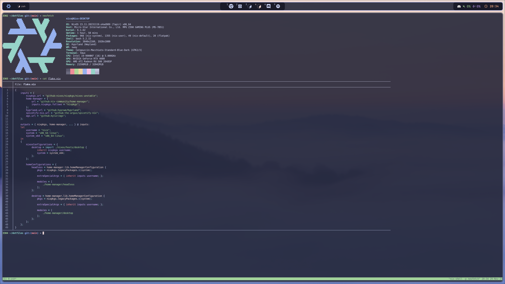
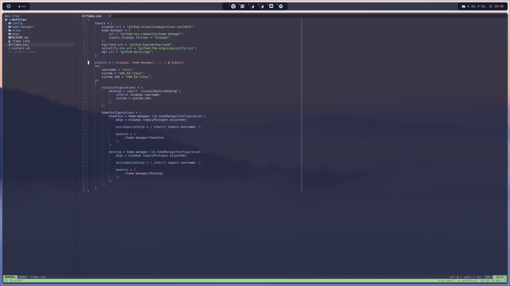

# Personal dotfiles

> [!WARNING]  
> *Heavily vibecoded with Claude Code Opus 5.5, because I am lazy and it is way more effective*

<b>OS</b>: Arch Linux (packages via Nix + Home Manager)

<b>Desktop Environment</b>: Hyprland

<b>Shell</b>: Zsh

<b>Editor</b>: Neovim

<b>Status Bar</b>: Quickshell

<b>Wallpaper / Lock</b>: hyprpaper / hyprlock

<b>Terminal</b>: kitty

<b>Application launcher / menus / clipboard</b>: Quickshell

<b>Browser</b>: Zen


|  |  |
|:---:|:---:|
|  |  |

## Installation

### Home Manager configuration (any OS)
Prerequisites for the install.sh script:
* `curl`
* `git`

<details open>
  <summary><b>Headless mode</b></summary>
  Command line only (useful on servers or in a TTY)
  
  ```sh 
  curl -L https://raw.githubusercontent.com/nimueller/dotfiles/main/install.sh | bash -s headless
  ```
</details>

<details open>
  <summary><b>Desktop mode</b></summary>
  Headless mode plus my desktop environment and applications
  
  ```sh
  curl -L https://raw.githubusercontent.com/nimueller/dotfiles/main/install.sh | bash -s desktop
  ```
</details>

