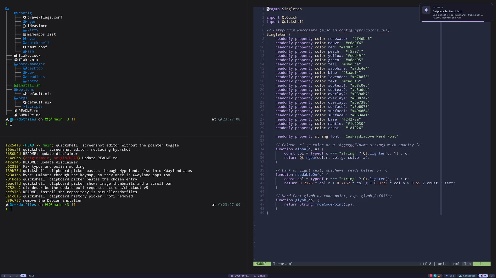
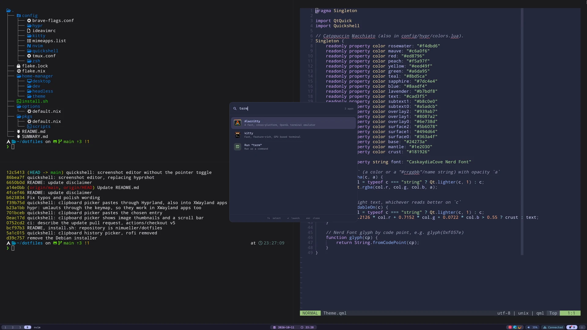
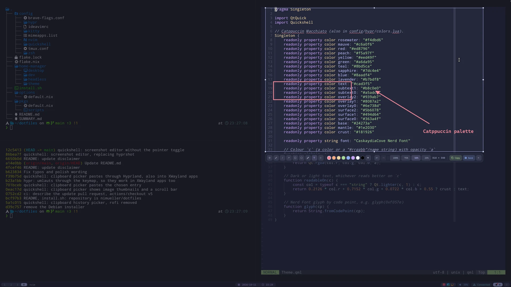
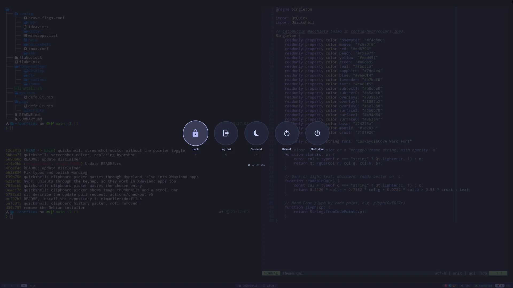

# Personal dotfiles

> [!WARNING]  
> *Heavily vibecoded with Claude Code Opus 5.5*
>
> Why vibecoding? Because I am lazy and it is way more effective: I can just tell Claude what I want from my desktop and dotfiles.

My Arch Linux setup: a [Hyprland](https://hyprland.org) desktop whose bar, menus, launcher, notifications and
screenshot tool are all written in [Quickshell](https://quickshell.org), plus Zsh and Neovim for the terminal.
Packages and configuration come from Nix with [Home Manager](https://github.com/nix-community/home-manager), and
everything wears [Catppuccin Macchiato](https://catppuccin.com).



## What's inside

| | |
|---|---|
| **OS** | Arch Linux, packages via Nix + Home Manager |
| **Compositor** | Hyprland, configured in Lua |
| **Shell UI** | Quickshell: bar, menus, launcher, clipboard history, notifications, on-screen display, screenshot editor |
| **Wallpaper / lock** | hyprpaper (rotating through `config/hypr/wallpapers`) / hyprlock, at login, when idle and before suspend |
| **Terminal** | kitty, Zsh with Powerlevel10k |
| **Editor** | Neovim with lazy.nvim, Treesitter, Telescope, Neo-tree and blink.cmp; language servers come from Nix |
| **Browser** | Brave from Flathub (Zen stays installed as a backup), with KeePassXC through a small proxy |
| **Markdown** | MarkText, the default for `.md` files (GitHub tables and task lists, KaTeX, Mermaid, GitLab mode) |
| **Theme** | Catppuccin Macchiato for everything, including GTK, the cursor, btop and bat |

## The Quickshell desktop

One resident Quickshell process holds the bar on every monitor, the launcher, the clipboard history, the notification
daemon and the on-screen display, so they open instantly. The bigger menus are started on demand and quit when they close.

| | |
|:---:|:---:|
|  |  |
| **Launcher:** type to filter, apps you use often come first, open windows that match come before them, or run the text as a command; it also does sums, and `:` searches emoji | **Screenshot editor:** select, adjust, draw, scale, then copy or save |
|  | |
| **Power menu:** lock, log out, suspend, reboot or shut down, by mouse or key | |

- **Bar:** workspaces, window title, clock, tray (with themed menus), camera, microphone and screen-sharing indicators, volume,
  battery, phone, network and a notification bell. Clicking a module opens its menu.
- **System:** host, kernel, uptime, pending updates, the use of CPU, memory, disk and GPU, and a brightness slider
  for each screen (the backlight, or monitors with DDC/CI).
- **Sound:** output and input devices and their volumes, per-app volume.
- **Network:** wired and Wi-Fi connections, plus VPNs (import OpenVPN or WireGuard files).
- **Calendar:** a month view with Nextcloud calendars (CalDAV: create, edit and delete appointments, with reminders) and
  read-only ICS subscriptions, a weather forecast per day and by the hour, and the current weather from the nearest
  airport's METAR report.
- **Notifications:** popups with a countdown bar, a notification centre with history and do not disturb. Clicking one
  goes to the window that sent it and removes it from the history. Nothing pops
  up while the screen is shared, and a music player's notification about its current track leaves no trace in the
  history. They replace dunst.
- **On-screen display:** volume, microphone, brightness (the backlight, or external monitors over DDC/CI), Caps Lock and
  Num Lock, and when the camera, microphone or screen sharing starts. It replaces SwayOSD.
- **Phone:** KDE Connect: the phone's battery in the bar; ring it, send files or the clipboard, ping it, and browse its
  files, which also show up in Files' sidebar while it's connected (next to Nextcloud, not as a bookmark). Files'
  context menu sends files to it.
- **Files' sidebar:** Downloads, Documents, Pictures and the other standard folders stay its first bookmarks; removing
  one puts it back.
- **Drives:** a notification with Open and Eject when a USB drive, memory card, disc or phone is plugged in.
- **Window details:** `SUPER + I` shows the focused window's title, class, PID, command, workspace, geometry and state;
  click a row to copy it.
- **Stay awake:** no idle lock while a browser or video player is playing, a game runs or Sunshine streams; the
  on-screen display says when that starts and ends.
- **Clipboard history:** cliphist with image thumbnails; the chosen entry is pasted right away, in Wayland and X11 apps.
- **Machine Settings:** this machine's displays (drag to arrange, mode, scale, rotation, HDR, which workspaces live
  where, the main monitor for notifications), environment variables, autostart programs and bar options, saved to the
  untracked `config/hypr/local.lua`.
- **Screenshots:** the screen freezes, you pick a region or window (or the whole monitor) and can still resize the box,
  draw on it (pen, line, arrow, boxes, highlighter, text, pixelate), scale it to 75, 50 or 25 %, then copy it or save
  it to `~/Pictures/Screenshots`.

## Keybindings

`SUPER` is the main modifier.

| Keys | Action |
|---|---|
| `SUPER + T` / `B` | kitty / Brave |
| `SUPER + E` | Files, floating (`SHIFT`: tiled) |
| `SUPER + D` | App launcher |
| `SUPER + V` | Clipboard history |
| `SUPER + SHIFT + S` | Screenshot: region or window |
| `SUPER + CTRL + SHIFT + S` / `Print` | Screenshot of the active window / the whole monitor |
| `SUPER + SHIFT + C` | Colour picker |
| `SUPER + Escape` | Lock the screen |
| `SUPER + I` | Details of the focused window |
| `SUPER + 1`…`0` | Go to workspace 1–10 (`SHIFT`: move the window there) |
| `SUPER + S` / `C` / `P` | Scratchpads for music, chat and passwords |
| `SUPER + H J K L` | Move the focus |
| `SUPER + arrows` / `SUPER + right mouse` | Resize the window |
| `SUPER + left mouse` | Move the window |
| `SUPER + F` / `M` / `SHIFT + M` | Float / maximise / fullscreen |
| `SUPER + G` / `SHIFT + G` | Group the window into tabs (new windows join the group) / take it out |
| `SUPER + Tab` / `SHIFT + Tab` | Next / previous tab of a group (`SUPER + H`/`L` too) |
| `SUPER + SHIFT + Q`, `ALT + F4` | Close the window |
| `SUPER + ;` `'` `[` `-` | ö ä ü ß on a US layout (`SHIFT` for capitals), in Wayland and X11 apps |
| Power button | Power menu |

## Installation

The script installs Nix (with flakes) if needed, clones this repository to `~/dotfiles` and applies a Home Manager
configuration. It needs `git`, `curl` and `xz`.

<details open>
  <summary><b>Headless</b>: command line only, for servers or a TTY</summary>

  ```sh
  curl -L https://raw.githubusercontent.com/nimueller/dotfiles/main/install.sh | bash -s headless
  ```
</details>

<details open>
  <summary><b>Desktop</b>: headless plus the Hyprland desktop and its applications</summary>

  ```sh
  curl -L https://raw.githubusercontent.com/nimueller/dotfiles/main/install.sh | bash -s desktop
  ```
</details>

Good to know:

- The configurations are made for my user name. To use them yourself, fork the repository and change `username` in
  `flake.nix` (and the clone URL in `install.sh`).
- The desktop session comes from pacman: Hyprland, hyprlock, hypridle, Quickshell, the portals and the services they
  talk to (`system/packages/session.txt`). Graphics drivers and login (PAM) belong to the system, which Nix packages
  can't use reliably outside NixOS. Everything else comes from Nix, GUI apps from Flathub
  (`home-manager/desktop/flatpak.nix`, installed by Home Manager), and the AUR only for what has no other source.
- For the desktop, the script runs `system/setup.sh`, which needs root and asks before every step: the session packages
  (and optionally this machine's other packages and AUR packages), PAM so that logging in on a TTY or unlocking the
  lock screen unlocks the keyring, LightDM's automatic login, logind so the power button opens the power menu instead
  of shutting down, the firewall (the network connection in the `home` zone, open only for SSH, Samba, KDE Connect,
  Sunshine, mDNS and DHCPv6) and Docker (container ports published on this machine only, since they would bypass the
  firewall).
- LightDM logs in by itself and the session locks right away, so the lock screen is the login screen: its password
  also unlocks the keyring, and the programs that need the keyring start after that. A machine woken by Wake-on-LAN
  can be unlocked over Sunshine. Without LightDM, run `start-hyprland` after logging in on a TTY.
- Settings that belong to one machine (monitors, driver variables, programs with private paths) go into
  `config/hypr/local.lua`, which git ignores. The **Machine Settings** app (in the launcher) edits it;
  `config/hypr/local.example.lua` shows the format. Without it, every monitor runs at its preferred mode.
- PAM only unlocks the keyring called `login`, with your login password, so keep every secret in that one keyring.
- Zsh becomes the login shell through a small hook in `~/.profile`, since Home Manager can't run `chsh`. The script asks
  before doing that.

## Repository layout

| Path | What it holds |
|---|---|
| `flake.nix` | The Home Manager configurations: `headless`, `headless_aarch64`, `desktop` and `runner` (CI) |
| `home-manager/headless` | Command line tools, Zsh, git, btop, and what Neovim's plugins need |
| `home-manager/desktop` | Fonts, Wayland tools, desktop apps, the Quickshell services and MangoHud |
| `home-manager/dev` | Language servers, formatters and toolchains (desktop only; several GB) |
| `home-manager/theme` | Catppuccin for btop and bat, GTK and the cursor |
| `options` | The `dotfiles` option: where this repository is checked out (`~/dotfiles`) |
| `system` | The root side: pacman package lists and `setup.sh` (packages, PAM, logind, firewall, Docker) |
| `pkgs` | Small scripts (`stay-awake`, `init-tex`, `edit-tex`), the Python for the calendar helper and the launcher's emoji list |
| `config` | The configuration files themselves: Hyprland, Quickshell, kitty, Neovim, Zsh, Sunshine |

The files in `config` are linked into `~/.config` with `mkOutOfStoreSymlink`, so `~/.config/<app>` points straight at
`~/dotfiles/config/<app>`: edits take effect without rebuilding. The Quickshell daemon is the one exception; restart it
with `~/.config/quickshell/menus/toggle.sh daemon --restart`.

Hyprland's config starts at `config/hypr/hyprland.lua`, and the desktop shell lives in `config/quickshell/menus`.

## Maintenance

- Apply changes to the Nix side with `home-manager switch --flake ~/dotfiles#desktop` (or `#headless`); this also
  installs and removes the declared Flatpaks.
- `pkg-sync` compares the installed packages and Flatpaks with the lists: what's installed but not declared, and the
  other way round. `pkg-sync adopt` adds packages to the lists, `pkg-sync prune` uninstalls them, `pkg-sync install`
  installs what's missing, and `pkg-sync aur PKG` checks an AUR package (maintainer, votes, age, download hosts, install
  scripts, its PKGBUILD) before it goes in.
- `./check.sh` runs all checks with the tool versions from `flake.lock`: nixfmt, statix and deadnix for Nix, shellcheck
  for the shell scripts, ruff for the Python (`ruff.toml`), and qmllint for syntax errors in the Quickshell code.
  `nix fmt` formats the Nix files. CI runs `check.sh` on every push and evaluates every configuration.
- Optional: `git config core.hooksPath .githooks` runs `check.sh` before every commit (`--no-verify` skips it).
- Every week, CI updates `flake.lock` in a pull request, builds the configurations with it and merges it when they
  build; otherwise it closes the pull request.
- Home Manager removes generations older than a week by itself.

## TODO

**Security and setup**
- [x] Unlock the keyring at login: `pam_gnome_keyring` for TTY logins (`system/setup.sh`), and a single `login` keyring
      instead of two
- [x] A settings app in Quickshell for the machine's own settings (monitor layout and scale, driver variables,
      private autostarts) that writes `config/hypr/local.lua`
- [x] Make the system half reproducible: tracked pacman package lists and a setup script for PAM and logind
- [x] Keep Hyprland and Quickshell in step: the whole session comes from pacman
- [x] A firewall setup in `system/setup.sh` that keeps Sunshine, KDE Connect and Samba reachable

**Portability**
- [x] Move the remaining machine-specific bits (workspaces bound to monitor ports, the notifications' monitor,
      `JAVA_HOME`) into `local.lua`

**Cleanup**
- [x] Trim `kitty.conf` to the settings that differ from the defaults
- [x] Shrink the wallpapers (30 MB → 4 MB; older commits still hold the old files)

**Checks**
- [x] Lint the Quickshell code (`qmllint`) and the calendar helper (`ruff`) in CI
- [x] A `formatter` in the flake, so `nix fmt` works locally, and an optional pre-commit hook

**Desktop features**
- [ ] Bluetooth menu
- [ ] Power profiles in the power menu, and a toggle that keeps the screen awake
- [ ] Night light with `hyprsunset`
- [x] Do not disturb while the screen is shared (the privacy module knows when)
- [x] Brightness keys for external monitors over DDC/CI (`ddcutil`); there is no backlight on the desktop
- [x] Open windows in the launcher, instead of a window switcher (Alt+Tab)
- [x] Window groups (tabs), for workspaces with many terminals
- [ ] Waiting updates at a glance: a dot on the bar's logo chip, and AUR updates too (the system menu only counts
      pacman updates, while it is open)
- [x] A notification for USB drives and phones when plugged in, with Open and Eject
- [x] Calculator and emoji search in the launcher
- [x] A shortcut that shows the focused window's details (title, class, PID, ...)
